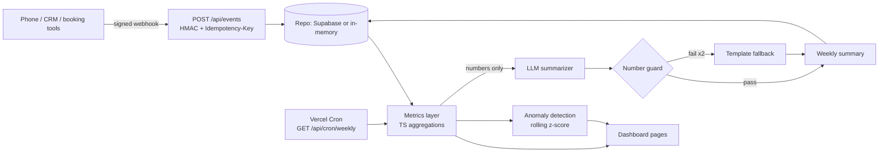

# Contractor AI Ops Dashboard

**Know where every call, lead and dollar goes.** Analytics and AI insights for home-service businesses (HVAC, plumbing, electrical): answer rate, missed-call recovery, speed to lead, conversion funnel, revenue by source, anomaly alerts, and a plain-English weekly summary whose numbers are machine-checked against the data.


<!-- TODO: add a screenshot of the Overview page at docs/screenshot.png -->

Stack: Next.js 14 (App Router) · TypeScript · Tailwind · Recharts · Supabase Postgres · Anthropic · Vercel Cron.

## Data flow



## Demo quick start

Runs with no external services: data is seeded in memory (90 days, two demo companies) and AI summaries are mocked.

```bash
git clone <this repo> && cd contractor-ai-ops-dashboard
cp .env.example .env.local     # DEMO_MODE=true, password "demo"
npm install
npm run dev                    # http://localhost:3000, sign in with password: demo
```

Send a signed event:

```bash
BODY='{"type":"job.completed","contact_id":"c-123","source":"lsa","value":420}'
TS=$(date +%s)
SIG="sha256=$(printf %s "$TS.$BODY" | openssl dgst -sha256 -hmac demo-secret-summit | awk '{print $2}')"
curl -X POST localhost:3000/api/events \
  -H "X-Org-Id: 00000000-0000-0000-0000-000000000001" -H "X-Timestamp: $TS" -H "X-Signature: $SIG" \
  -H "Idempotency-Key: job-123" -d "$BODY"
# 201 created; repeat the same call -> 200 {"duplicate":true}
```

Trigger the weekly summary: `curl -H "Authorization: Bearer $CRON_SECRET" localhost:3000/api/cron/weekly`.

### With Supabase

1. Run `supabase/schema.sql` in the SQL editor.
2. Set `SUPABASE_URL` and `SUPABASE_SERVICE_ROLE_KEY`, then `npm run seed` to load the demo orgs and 90 days of events. (Without those variables, `npm run seed` writes `supabase/seed.sql` instead.)
3. Deploy to Vercel; `vercel.json` schedules the weekly cron (Mondays 13:00 UTC). Set `CRON_SECRET`; Vercel sends it as a bearer token.

## Events API

`POST /api/events` with headers `X-Org-Id`, `X-Timestamp` (unix seconds, within 5 minutes of server time), `X-Signature: sha256=<hex HMAC-SHA256 of "<timestamp>.<raw body>", keyed by the org's webhook secret>` and `Idempotency-Key`.

```json
{ "type": "call.missed", "contact_id": "c-9", "source": "google_ads", "occurred_at": "2026-03-01T10:00:00Z" }
```

Types: `call.missed`, `call.answered`, `sms.sent`, `lead.created`, `booking.created`, `job.completed` (requires `value` in dollars), `review.requested`. Responses: `201` stored, `200` duplicate key, `400` missing key/bad JSON, `401` bad/expired signature or unknown org (same response, no tenant enumeration), `422` invalid payload.

## Environment

| Variable | Required | Purpose |
| --- | --- | --- |
| `DEMO_MODE` | no | `true` = mock AI summaries, default password `demo`, built-in session secret. Do not use in production. |
| `DEMO_PASSWORD` | no | Password for the demo login. |
| `SESSION_SECRET` | outside demo | Signs the session cookie (HMAC-SHA256, 7-day expiry). |
| `CRON_SECRET` | for cron | Bearer token required by `/api/cron/weekly`. |
| `SUPABASE_URL`, `SUPABASE_SERVICE_ROLE_KEY` | no | Use Supabase Postgres; unset = seeded in-memory store. |
| `ANTHROPIC_API_KEY` | no | Real summaries (ignored when `DEMO_MODE=true`). |
| `ANTHROPIC_MODEL` | no | Defaults to `claude-sonnet-5-5`. |

## Metric definitions

All math is in [`src/lib/metrics.ts`](src/lib/metrics.ts). Dates are UTC; weeks start Monday. Everything is computed from events inside the selected date range.

| Metric | Definition |
| --- | --- |
| Answer rate | `call.answered / (call.answered + call.missed)` |
| Missed-call recovery rate | Contacts with a `call.missed` who then have a `booking.created` within 7 days of the miss, divided by contacts with a `call.missed` |
| Revenue recovered | Sum of `job.completed` value, at or after the recovery booking, for recovered contacts |
| Speed to lead | Median minutes from a contact's first inbound touch (`call.missed` or `lead.created`) to their first `sms.sent` at or after it |
| Funnel | Leads (contacts with `lead.created`) to those with a booking to those that also completed a job |
| Conversion (by source) | Lead contacts that booked and completed a job, divided by lead contacts; source comes from `lead.created` |
| Revenue | Sum of `job.completed` value |
| Anomaly | Daily answer rate and lead count vs the previous 14 days (current day excluded, 7 minimum): `z = (x - mean) / sd`, flagged at `|z| >= 2.5`, critical at `>= 3.5`. A high answer rate is never alerted. |

## AI weekly summary and the number guard

The model receives only computed facts (rates as percentages, money in whole dollars, week-over-week changes pre-computed) and must return JSON: a summary and exactly three actions. Every numeric token in its output is extracted and must exist in the input (natural rounding of an input figure is allowed; new arithmetic is not). On failure it retries once, then falls back to a deterministic template built from the same facts. Limits: the guard checks numbers, not claims, so it cannot catch a wrong sentence built from correct numbers, and a hallucinated number that happens to equal a provided one passes.

## Multi-tenancy and auth

Every repo call takes an `orgId`, and the session cookie carries it. `supabase/schema.sql` adds RLS keyed on `org_members`, so direct client access with Supabase Auth is also scoped. The demo login (shared password plus signed cookie) is a stand-in: for production, replace `src/lib/auth.ts` with Supabase Auth and map `auth.uid()` to an org through `org_members`.

## Scripts

`npm run dev | build | lint | typecheck | test | seed`. CI (`.github/workflows/ci.yml`) runs lint, typecheck, tests and build.

## Known limits

Hours in the heatmap are UTC, not the business's time zone. The in-memory store resets on restart. Contacts are keyed by `contact_id` within the selected range, so a lead created before the range start has no source inside it. Metrics are computed on read, which suits tens of thousands of events; beyond that, materialize the SQL view or rollups.

MIT, (c) 2026 Hussain.
